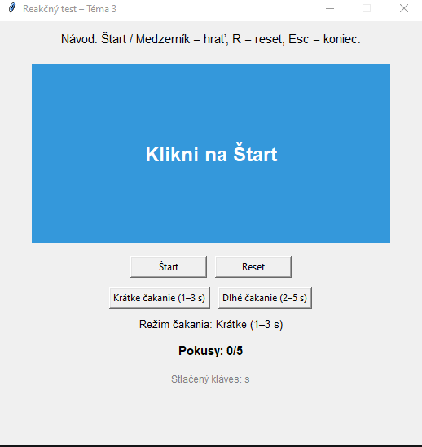

# Reakčný test (Tkinter – udalosti)

- **Meno:** Tvoje Meno
- **Číslo témy:** 3 – Reakčný test

## Ovládanie
- **Tlačidlo Štart** – spustí nové kolo (po náhodnom čase sa plocha zmení na zelenú).
- **Ľavý klik na plátno** – zaznamená reakciu (na zelenej zmeria čas, na červenej hlási skorý klik) a vykreslí miesto kliknutia (`event.x`, `event.y`).
- **Medzerník (`space`)** – spustí kolo alebo zaznamená reakciu.
- **Kláves `R` / tlačidlo Reset** – vynuluje všetky pokusy a vráti aplikáciu do počiatočného stavu.
- **Kláves `Escape`** – bezpečne ukončí aplikáciu.
- **Tlačidlá Krátke / Dlhé čakanie** – menia rozsah náhodného čakania cez `lambda`.

## Screenshot
